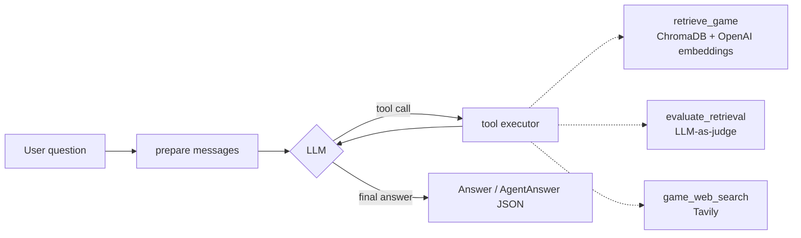

# Game Research Agent

A tool-using LLM agent that answers questions about video games. It searches a local vector knowledge base first, has an LLM judge decide whether the retrieved evidence is good enough, and falls back to live web search when it is not. Answers can be returned as validated, structured JSON with citations.

```text
$ research-agent ask "Was Mortal Kombat X released for PlayStation 5?" --json
{
  "answer": "Not at launch (2015, PS4/Xbox One), but it is playable on PS5 via the PlayStation Plus Collection.",
  "source": "web",
  "citations": ["https://www.mortalkombatonline.com/..."],
  "confidence": "medium"
}
```
<sub>Illustrative output; real transcripts are in [docs/sample_runs.md](docs/sample_runs.md).</sub>

## Why this design

| Problem | Approach |
| --- | --- |
| LLMs hallucinate facts such as release dates | Ground answers in retrieved documents and web results; instruct the model never to invent facts |
| A knowledge base is always incomplete | **Retrieve -> judge -> fall back**: an LLM-as-judge (`evaluate_retrieval`) gates a web-search fallback |
| Free-text answers are hard to consume downstream | `Agent.ask()` returns a Pydantic-validated `AgentAnswer` (answer, source, citations, confidence) |
| Agent loops can run away or crash on bad tool calls | Per-turn tool-round cap; unknown or failing tool calls are returned to the model as errors instead of raising |
| Multi-turn context | Per-session short-term memory of full runs |

## Architecture



The agent loop is an explicit state machine (`prepare -> llm <-> tools -> end`) that records a snapshot of the state after every step, so each run can be inspected. See [docs/architecture.md](docs/architecture.md).

## Quickstart

Requires Python 3.11+, an OpenAI API key and a [Tavily](https://tavily.com) API key.

```bash
git clone <this-repo> && cd <this-repo>
python -m venv .venv && source .venv/bin/activate
pip install -e ".[dev]"

cp .env.example .env        # then add OPENAI_API_KEY and TAVILY_API_KEY

research-agent ingest       # embed data/games into a local ChromaDB (.chroma/)
research-agent ask "When was Pokémon Gold and Silver released?"
research-agent ask "Who published Gran Turismo?" --json
research-agent chat         # multi-turn session with memory
```

Add `-v` for step-by-step logging. The OpenAI base URL, chat model and embedding model are configurable (see [.env.example](.env.example)), so any OpenAI-compatible endpoint works.

## Project layout

```text
src/research_agent/
  agent.py          Agent loop (state machine), structured AgentAnswer
  state_machine.py  Generic steps/transitions/snapshots, with a max-step guard
  tooling.py        @tool decorator: Python function -> OpenAI function schema
  tools/            retrieve_game, evaluate_retrieval, game_web_search
  vectorstore.py    ChromaDB wrapper: idempotent ingest, semantic search
  llm.py            OpenAI wrapper (client injectable for tests)
  memory.py         Per-session run history
  config.py         Env-driven settings
  cli.py            ingest / ask / chat
data/games/         15 game records (JSON)
tests/              Offline unit tests (no network)
evals/              Live end-to-end checks with pass/fail report
docs/               Architecture notes and sample runs
```

## Testing and evaluation

```bash
pytest                     # offline: fake OpenAI client + deterministic embeddings
ruff check .
python evals/run_evals.py  # live: runs evals/cases.json against the real models
```

Unit tests cover schema generation, the state machine (including the loop guard), session memory, vector-store ingest and search, the full agent loop with scripted tool calls, error handling, and structured output. CI runs lint and tests on Python 3.11 and 3.12.

## Design decisions and trade-offs

- **Dependency injection over globals.** The OpenAI client and embedding function are injected, which makes the agent fully testable offline.
- **Idempotent ingestion.** `upsert` by file id, so re-running `ingest` never duplicates documents.
- **Judge before fallback.** An extra LLM call costs latency and tokens but prevents confidently answering from an irrelevant retrieval hit.
- **Errors go to the model.** A failed tool call becomes a tool message the model can recover from rather than a crash.

## Limitations and roadmap

- The knowledge base holds only 15 games; coverage is intentionally small.
- Retrieval quality is judged by an LLM, not measured with labelled retrieval metrics (recall@k, MRR).
- The eval set is small (4 cases) and uses substring matching.
- Short-term memory is in-process only; no persistence across restarts.
- Next: larger dataset, retrieval metrics, long-term memory, streaming output, a web UI.

## Tech stack

Python 3.11+, OpenAI API (chat + `text-embedding-3-small`), ChromaDB, Tavily, Pydantic v2, pytest, ruff, GitHub Actions.

## License

MIT, see [LICENSE](LICENSE).
